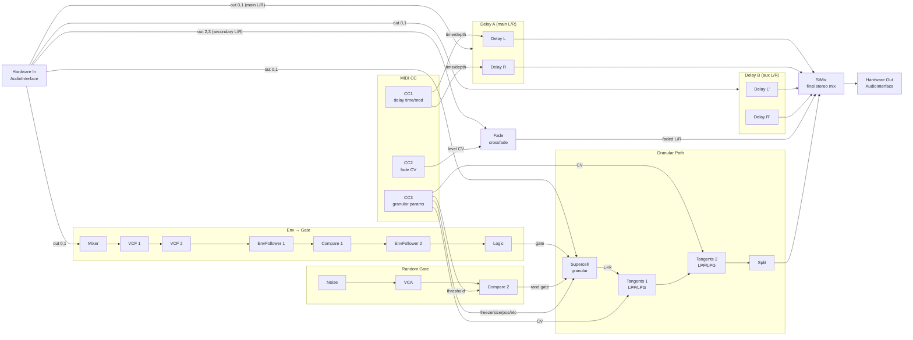

# VCV SA Combined — Signal Flow

Patch: `sound/racks/vcv-2-sa-combined.vcv`

Two stereo inputs combined: main L/R through granular + delays, secondary L/R through a MIDI-controlled crossfader. All paths meet at StMix → hardware out.

## Paths summary

| Path | Source | Processing | Dest |
|---|---|---|---|
| Delay A | HW in L/R | Dual delay, CC1-modulated | StMix ch 2/3 |
| Delay B | HW in L/R | Second delay pair | StMix ch 6/7 |
| Fade | HW in 2nd L/R | Fade crossfader, CC2 CV | StMix ch 0/1 |
| Granular | HW in L/R | Supercell → 2× Tangents LPG | StMix ch 4/5 |

## Key modulation

- **CC1** — Delay A time/depth (3 CCs mapped to Delay L + R params)
- **CC2** — Fade crossfade amount
- **CC3** — Supercell granular params (freeze, size, position, pitch, scatter) + Tangents cutoff/resonance
- **Env gate** — input amplitude (after VCF bandpass) → env follower → Compare → Logic → Supercell gate trigger
- **Noise gate** — pink noise shaped by VCA, thresholded by CC3 → random grain triggers into Supercell

## Torso S4 mapping hints

- **Delay A/B** → S4 delay send/return (or Time param per step)
- **Fade** → S4 crossfade or morph between two clips/patterns
- **Supercell granular** → S4 grain engine; map CC3 params to encoders (freeze, size, pos, scatter)
- **Env gate** → S4 envelope follower on input → gate/trigger track
- **Tangents** → S4 filter with resonance; two in series or one per stereo side
- **StMix** → S4 mixer or final output bus
